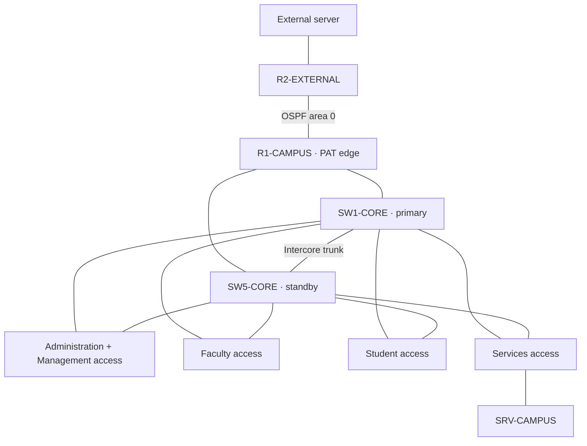

# Secure Campus Network with Centralized Services

**Campus Atlas** combines a Cisco Packet Tracer campus-network project with an interactive evidence viewer. The current documented network is **Version 02: verified remediation Iteration 5**, captured on **6 November 2026**. It contains **60 devices, 64 physical links, 50 PCs and two servers**. Documentation and source validation were refined on **7 November 2026**.

## Objective

Design, implement and verify a campus network that gives Administration, Faculty and Students access to centralized services while enforcing departmental boundaries, restricting device management and maintaining service after a single core-switch failure. Demonstrate addressing, switching, routing, access control and recovery through reproducible evidence and an interactive teaching interface.

Campus Atlas replays recorded topology and test results. It is an evidence viewer, not a live network monitor or an ICMP client.

## Table of contents

- [Versioned documentation](#versioned-documentation)
- [Technology stack](#technology-stack)
- [Networking topologies](#networking-topologies)
- [Addressing and centralized services](#addressing-and-centralized-services)
- [Networking protocols](#networking-protocols)
- [Access control policies](#access-control-policies)
- [Run the project](#run-the-project)
- [Verification and limitations](#verification-and-limitations)
- [Project layout and maintenance](#project-layout-and-maintenance)

## Versioned documentation

The paired guides describe the existing website editions and their engineering iterations. The final README consolidates these guides; detailed claims link back to configuration and test evidence.

| Topic | Version 01 — original explorer | Version 02 — dual-core campus |
| --- | --- | --- |
| Objective, scope and iterations | [Overview](docs/versions/version-01/overview.md) | [Overview](docs/versions/version-02/overview.md) |
| Topology, addressing and protocols | [Architecture](docs/versions/version-01/network-architecture.md) | [Architecture](docs/versions/version-02/network-architecture.md) |
| Access controls and security limits | [Policies](docs/versions/version-01/access-controls.md) | [Policies](docs/versions/version-02/access-controls.md) |
| Evidence and reproduction | [Verification](docs/versions/version-01/verification.md) | [Verification](docs/versions/version-02/verification.md) |

| Property | Version 01 | Version 02 |
| --- | --- | --- |
| Capture | 2 November 2026 | 6 November 2026; remediation Iteration 5 |
| Devices / links | 58 / 57 | 60 / 64 |
| Inter-VLAN routing | R1 router-on-a-stick | Two multilayer core switches with HSRP |
| Management workstation | VLAN 10, 192.168.10.98 | VLAN 99, 192.168.10.146 |
| Ping scope | 3,224 commands, including infrastructure targets | 2,652 directed endpoint pairs, grouped into 33 scenarios |
| Website URL fragment | #version-01 | #version-02 |

The November 5 backup-uplink milestone has **58 devices / 60 links** and separate evidence. JSON filenames ending in v3 and remediation iterations 0–6 are separate naming sequences; see the [version index](docs/versions/README.md). The November 7 source changes are recorded in the [codebase analysis and refinement report](docs/CODEBASE_REVIEW.md).

## Technology stack

Versions below are the project's declared dependencies, not claims about the latest upstream releases.

| Layer | Technologies / role |
| --- | --- |
| Network simulator | Cisco Packet Tracer 9.0.1; simulated IOS CLI and Server-PT services |
| Current network equipment | Cisco 2911 campus edge, 1941 external router, two 3650 multilayer cores and four 2960 access/services switches |
| User interface | React 19.3.1, React DOM, TypeScript 7.0.2, CSS Modules |
| Topology visualization | @xyflow/react 12.12.0 (React Flow) |
| Build and tests | Node.js 24, npm lockfile, Vite 8.3.5, Vitest 5.0.5 |
| Automation and verification | Python 3; standard-library verification/tests; aiohttp and the adjacent cisco-pt-mcp bridge for live operations |
| Evidence and documentation | JSON captures, SHA-256 manifests, sanitized IOS text exports, Markdown and printable PDFs |

There is no database or required application backend for the viewer. Static build assets contain the recorded evidence. See [website/package.json](website/package.json), [website maintenance](website/README.md) and the [codebase review](docs/CODEBASE_REVIEW.md).

## Networking topologies

**Version 01** uses an extended star: one core switch aggregates the departmental access switches, with a single trunk to the router. **Version 02** uses a redundant hierarchical star with partial mesh connectivity: each access switch connects to both cores, the cores connect to one another, and each core has a separate routed link to R1. The external branch uses point-to-point links.



VLANs form the logical broadcast domains. Rapid PVST+ prevents Layer 2 loops; HSRP supplies virtual gateways. Both cores perform inter-VLAN routing, enforce inbound SVI ACLs and relay DHCP. R1 uses preferred and floating static campus routes, authenticated OSPF toward R2 and PAT for departmental clients. Full port and addressing details are in [Version 02 architecture](docs/versions/version-02/network-architecture.md).

## Addressing and centralized services

The campus uses VLSM within 192.168.10.0/24. The 50 PCs comprise **11 Administration, 18 Faculty, 20 Students and one management workstation**.

| VLAN | Purpose | Subnet | HSRP gateway | Allocation |
| --- | --- | --- | --- | --- |
| 30 | Students | 192.168.10.0/26 | 192.168.10.1 | DHCP .2–.60 |
| 20 | Faculty | 192.168.10.64/27 | 192.168.10.65 | DHCP .66–.92 |
| 10 | Administration | 192.168.10.96/27 | 192.168.10.97 | DHCP .103–.126 |
| 40 | Services | 192.168.10.128/28 | 192.168.10.129 | Static server 192.168.10.130 |
| 99 | Management | 192.168.10.144/28 | 192.168.10.145 | Static PC8-MGMT 192.168.10.146 and device interfaces |
| 998 / 999 | Unused-port / native VLAN | No client subnet | — | Shutdown unused ports / unused native VLAN |

SRV-CAMPUS supplies **DHCP to 49 clients**, DNS for **portal.campus.test → 192.168.10.130**, and the internal **HTTP portal**. It also supports the recorded NTP/syslog work. The external demonstration server is **203.0.113.10**, reached through the **198.51.100.0/30** OSPF transit. This is a simulated external network, not general Internet access.

## Networking protocols

| Protocol / mechanism | Purpose |
| --- | --- |
| Ethernet, ARP, IPv4 | Local frames, next-hop MAC resolution and packet delivery |
| IEEE 802.1Q VLAN trunking | Carry separated departmental, services and management VLANs |
| Rapid PVST+ | Loop-free redundant Layer 2 paths |
| HSRP, UDP 1985 | Shared default gateways across the two cores |
| DHCP, UDP 67/68 | Central address assignment with core SVI relay |
| DNS, UDP/TCP 53 | Campus hostname resolution; UDP verified, TCP permitted but not tested end to end |
| HTTP, TCP 80 | Campus and external demonstration websites |
| ICMP | Diagnostics, policy checks and ping replay |
| SSHv2, TCP 22 | Restricted device administration |
| OSPFv2, IP protocol 89 | Area 0 adjacency and external routing; MD5 authentication in Version 02 |
| PAT / NAT overload | Share R1's external IPv4 address for allowed departmental traffic |
| NTP, UDP 123; syslog, UDP 514 | Time synchronization and recorded event collection |

Port security, DHCP snooping, PortFast, BPDU Guard, restricted trunk VLANs and DTP suppression complement the routed access policies. See [protocol details and topology](docs/versions/version-02/network-architecture.md).

## Access control policies

| Initiator → target | Policy |
| --- | --- |
| Same departmental VLAN | Local switching; routed ACLs are not traversed |
| Department → campus services | DHCP, DNS, HTTP and ICMP explicitly permitted |
| Administration → Faculty / Students | Diagnostic ICMP allowed |
| Faculty / Students → another department | Newly initiated cross-department ICMP denied |
| Management → departmental clients | Diagnostic ICMP permitted |
| PC8-MGMT → seven campus IOS devices | SSH allowed from 192.168.10.146; VTY source ACL and local authentication |
| Other workstations → device CLI | Denied |
| Department → external server | HTTP and ICMP to 203.0.113.10 through PAT |
| Management → external server | Denied; management excluded from NAT-CLIENTS |
| Services → clients | Required service replies allowed; new ping initiation denied |
| External → private campus | R2 lacks private campus routes; WAN-IN separately restricts traffic reaching R1 |

ADMIN-IN, FACULTY-IN, STUDENTS-IN, SERVICES-IN and MGMT-IN are applied on both cores. WAN-IN applies on the edge. Rules are ordered, with explicit return permissions and final denial. These are **stateless ACLs**: TCP established checks and ICMP reply rules do not track sessions. The dedicated management VLAN is **in-band**, and successful same-VLAN traffic does not prove a routed permission. [Detailed policy and enforcement](docs/versions/version-02/access-controls.md)

## Run the project

From this project directory in PowerShell:

```powershell
cd website
.\run.ps1 test
.\run.ps1 build
.\run.ps1 preview
```

Open [Campus Atlas locally](http://127.0.0.1:4173/). Version 02 is the default when its capture is present. Select Version 01 to inspect the historical explorer. Stop the server with Ctrl+C. For editing, run `.\run.ps1 dev` and use the printed local URL, normally port 5173.

The helper selects Node 24 and restores missing packages with the npm lockfile. On other platforms with Node 24 installed, run `npm ci`, `npm test`, `npm run build` and `npm run preview` from website/. A completed dist/ build can also be served using Python 3; the PowerShell preview helper supports that fallback.

For the simulator demonstration, open the locally supplied Secure_Campus_Network_Submission.pkt in Packet Tracer 9.0.1 and allow convergence. Use a client's Desktop → Web Browser to open `http://portal.campus.test`. This hostname exists inside the simulation; it is separate from the localhost viewer. Private .pkt files, lab credentials and recovery ZIPs are excluded from Git.

## Verification and limitations

Recorded Version 02 results include 2,652 matching endpoint-pair outcomes, 50/50 campus ICMP/DNS/HTTP/gateway checks, 49/49 external client checks and 7/7 authorized campus SSH checks. Both core-outage cases verified service recovery and policy isolation. First successful probe batches ended after 43.64 seconds for SW1 loss and 29.07 seconds for SW5 loss; these are measured simulator observations, not uptime guarantees. [Verification guide and evidence](docs/versions/version-02/verification.md)

From the project root:

```powershell
python -m unittest discover -s scripts/tests -v
python scripts/verify_audit_remediation.py
```

The checkpoint verifier requires the local simulation and matching private checkpoint ZIP. From website/, `.\run.ps1 verify-source` checks that the local .pkt matches Version 02. Ordinary viewing can use recorded evidence without that file.

The November 7 refinement passed **71 JavaScript tests, six Python tests, TypeScript compilation and the production build**. Normal and optimized Python verified the saved checkpoint. No new live network tests were performed during this cleanup. [Codebase review](docs/CODEBASE_REVIEW.md)

Remaining boundaries include the single edge router, access switches and servers; unmeasured throughput; unencrypted HTTP; and simulator-specific security support. DAI was rolled back, IP Source Guard and the attempted RADIUS client setup were unsupported, switch NTP authentication did not persist, and stateful WAN inspection was not accepted. These limitations are part of the [security record](docs/versions/version-02/access-controls.md), not implemented features.

## Project layout and maintenance

| Location | Purpose |
| --- | --- |
| [website/](website/) | React application, topology logic, build and test tools |
| [data/](data/) | Versioned snapshot projections and matrices; retain capture identities |
| [scripts/](scripts/) | Capture, remediation, local bridge and verification utilities |
| [evidence/](evidence/) | Dated commands, tests, manifests and sanitized configurations |
| [Current configuration exports](evidence/AUDIT-REMEDIATION-20261105-182333/iteration5-verified-configs/) | Authoritative Version 02 device references; credentials redacted |
| [configs/](configs/) | Earlier exports, including November 5 files named CURRENT; not the dual-core authority |
| [docs/versions/](docs/versions/README.md) | Version 01 and Version 02 documentation set |
| [output/pdf/](output/pdf/) | Printable historical campus labs |
| Local archive/ and private checkpoint ZIPs | Recovery material excluded from Git |

Edit source components or source captures through the appropriate workflow, not generated public/ assets or dist/. Synchronization validates evidence before preparing browser assets. See the [website maintenance guide](website/README.md).

Supporting records remain available: [audit remediation](docs/audit-remediation.md), [remediation presentation](output/presentation/CampusAtlas_Audit_Remediation_Iteration_5.pptx), [fault tolerance](docs/fault-tolerance.md), [fault-tolerance acceptance](FAULT_TOLERANCE_ACCEPTANCE.md), [OSPF/PAT extension](docs/ospf-pat-extension.md), [extension acceptance](OSPF_PAT_ACCEPTANCE.md), [scale design](SCALE_50_DESIGN.md), [ping analysis](PING_ANALYSIS.md), [tests conducted](docs/tests-conducted.md) and [lab walkthroughs](docs/lab-walkthroughs.md). Historical files describe their own capture dates.
