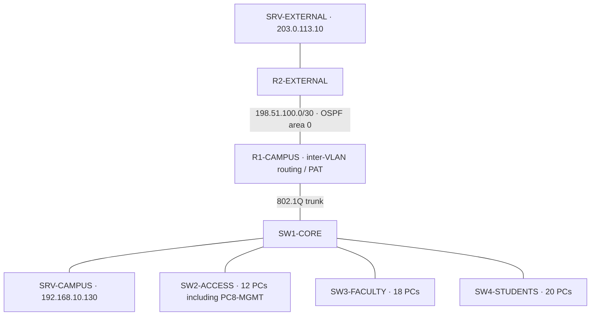

# Version 01 — topology, addressing and protocols

This guide describes the **November 2, 2026** capture. It has 58 devices and 57 physical links.

## Physical and logical topology

The campus is a hierarchical extended star. SW1-CORE aggregates three departmental switches and directly connects SRV-CAMPUS. R1 routes between VLANs over one IEEE 802.1Q trunk, commonly called router-on-a-stick. The R1–R2 transit is a point-to-point branch.

The physical topology is not a bus, ring or full mesh. VLANs create separate logical broadcast domains over the switching hierarchy. Same-VLAN traffic is switched locally; cross-VLAN traffic traverses R1.

## Address plan

| VLAN / segment | Network | Gateway | Allocation |
| --- | --- | --- | --- |
| 30 Students | 192.168.10.0/26 | 192.168.10.1 | DHCP .2–.62 |
| 20 Faculty | 192.168.10.64/27 | 192.168.10.65 | DHCP .66–.94 |
| 10 Administration | 192.168.10.96/27 | 192.168.10.97 | DHCP .103–.126; PC8-MGMT .98; switches .99–.102 |
| 40 Services | 192.168.10.128/28 | 192.168.10.129 | Static server .130; constrained default server pool .131 |
| OSPF transit | 198.51.100.0/30 | Not a client LAN | R1 .1, R2 .2 |
| External LAN | 203.0.113.0/24 | 203.0.113.1 | Server 203.0.113.10 |

VLSM sizes the client subnets to their populations. A recorded DHCP address is an observation, not a permanent host assignment.

## Protocol and service path

| Protocol / mechanism | Role in this edition |
| --- | --- |
| Ethernet, ARP, IPv4 | Local frame delivery, gateway MAC resolution and IP forwarding |
| VLANs and IEEE 802.1Q | Departmental separation and tagged trunks |
| PVST+; PortFast / BPDU Guard | Baseline loop prevention and edge-port protection; the later backup-link milestone uses Rapid PVST+ |
| DHCP, UDP 67/68 | SRV-CAMPUS serves 49 dynamic clients; R1 subinterfaces relay with ip helper-address |
| DNS, UDP/TCP 53 | portal.campus.test resolves to 192.168.10.130; UDP tested, TCP allowed but not tested end to end |
| HTTP, TCP 80 | Internal portal and narrowly permitted external server access |
| ICMP | Directional diagnostics and recorded ping outcomes |
| SSHv2, TCP 22 | Restricted management sessions |
| OSPFv2, IP protocol 89 | R1–R2 routing in area 0; private campus subnets are not advertised to R2 |
| PAT / NAT overload | Departmental clients share R1's external interface address for permitted flows |

A remote service request follows client → access switch → SW1 → R1 → destination VLAN or external branch. Return ACL entries permit the required reply. HTTP is unencrypted. PAT is address translation and does not supply stateful firewall inspection.

[Access controls](access-controls.md) · [Verification](verification.md) · [Version index](../README.md)
