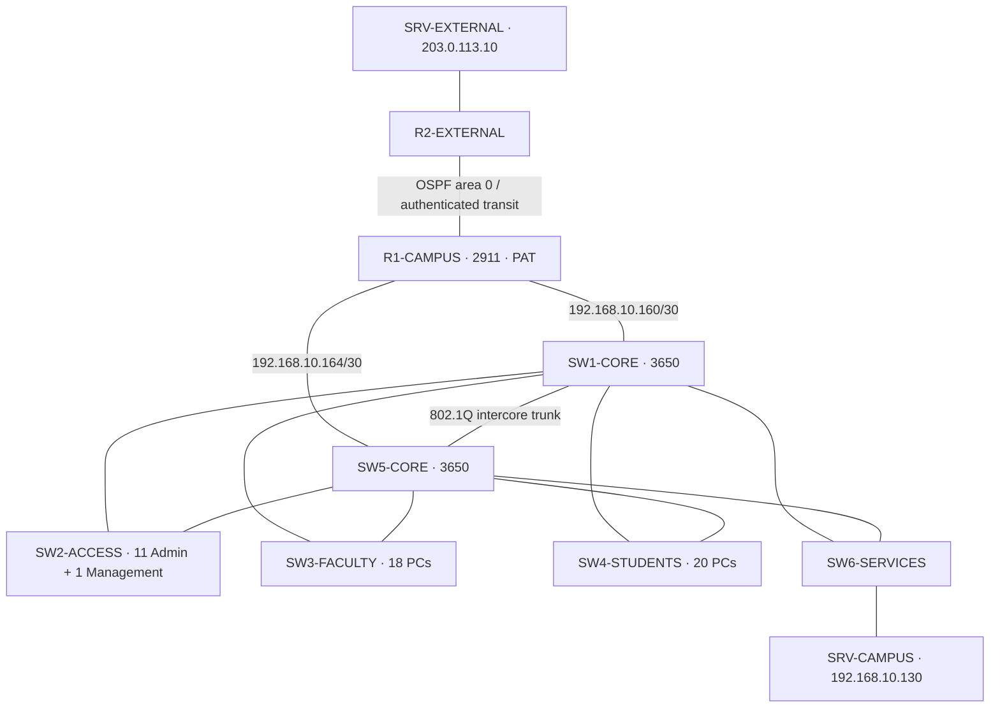

# Version 02 — topology, addressing and protocols

Source: [Iteration 5 sanitized configurations](../../../evidence/AUDIT-REMEDIATION-20261105-182333/iteration5-verified-configs/) and [release topology](../../../data/audit-release.json).

## Topologies used

The physical design is a **redundant hierarchical star with partial mesh connectivity** between the two cores, edge and access layer. It is not a full mesh. Each access switch and the services switch connects to both cores; the cores have an intercore trunk. Endpoint connections remain individual access links.

Logically, VLANs separate broadcast domains. Rapid PVST+ selects loop-free Layer 2 paths; HSRP provides a shared default-gateway address for each campus VLAN. SW1 is the preferred STP root and HSRP active core. These are separate mechanisms: HSRP does not replace spanning tree.

Inter-VLAN routing now occurs on the **core SVIs**. R1 provides the external edge and PAT. Each core has a default route to its R1 link; R1 has preferred static routes via SW1 and floating static routes (administrative distance 10) via SW5. OSPF area 0 operates between R1 and R2, not throughout the campus.

## VLSM and addressing

| VLAN / segment | Subnet | Virtual gateway | SW1 / SW5 | Assignment |
| --- | --- | --- | --- | --- |
| 30 Students | 192.168.10.0/26 | .1 | .61 / .62 | DHCP .2–.60 |
| 20 Faculty | 192.168.10.64/27 | .65 | .93 / .94 | DHCP .66–.92 |
| 10 Administration | 192.168.10.96/27 | .97 | .98 / .99 | DHCP .103–.126 |
| 40 Services | 192.168.10.128/28 | .129 | .131 / .132 | SRV-CAMPUS .130; default pool constrained to .133 |
| 99 Management | 192.168.10.144/28 | .145 | .147 / .151 | Static PC8-MGMT .146; SW2–SW4 .148–.150; SW6 .152 |
| Edge–SW1 | 192.168.10.160/30 | — | R1 .161 / SW1 .162 | Routed link |
| Edge–SW5 | 192.168.10.164/30 | — | R1 .165 / SW5 .166 | Routed link |
| R1–R2 | 198.51.100.0/30 | — | R1 .1 / R2 .2 | Authenticated OSPF transit |
| External LAN | 203.0.113.0/24 | 203.0.113.1 | — | SRV-EXTERNAL .10 |

Short addresses in campus rows use prefix 192.168.10. VLAN 998 parks unused shutdown ports; VLAN 999 is the unused native VLAN. Neither is a client IP subnet. The intercore trunk allows 10,20,30,40,99; access trunks allow their department/service VLAN plus 99. The native VLAN is not part of the service allowlist.

## Protocols and centralized services

| Protocol / mechanism | Use and implementation boundary |
| --- | --- |
| Ethernet, ARP, IPv4, VLSM | Local forwarding, gateway resolution and subnet allocation |
| IEEE 802.1Q | VLAN trunks with restricted allowlists and DTP negotiation disabled |
| Rapid PVST+, PortFast, BPDU Guard | Redundant switching paths and edge-port protection |
| HSRP, UDP 1985 | Virtual gateways on both cores; 3-second hello and 40-second hold in the recorded runtime |
| DHCP, UDP 67/68 | 49 dynamic clients; both cores relay from physical client SVIs to SRV-CAMPUS |
| DHCP snooping | Client VLAN protection with trusted infrastructure paths and Option 82 insertion disabled |
| DNS, UDP/TCP 53 | portal.campus.test → 192.168.10.130; UDP behavior verified |
| HTTP, TCP 80 | Campus portal and external demo service; no TLS |
| ICMP | Reachability, policy and failure-recovery probes |
| SSHv2, TCP 22 | Campus CLI management from PC8-MGMT |
| OSPFv2, IP protocol 89 | External area 0 adjacency with MD5 authentication; R2 does not learn campus private routes |
| PAT | Departmental sources translated to 198.51.100.1 on R1 |
| NTP, UDP 123; syslog, UDP 514 | Time synchronization and event collection at the campus server; switch authentication persistence is limited |

A Student → external HTTP request goes through its access switch, active core SVI/ACL, R1's PAT edge, R2 and the external server. The reply follows the PAT mapping back. A Student → Faculty initiation stops at the source core SVI ACL.

## Availability boundaries

The recorded outages exercise complete loss of either core. First successful probe batches ended after 43.64 seconds (SW1 loss) and 29.07 seconds (SW5 loss). These are simulator wall-clock observations, not guaranteed convergence times. HSRP, STP and static-route failover must not be described as zero-loss recovery.

R1, R2, each departmental switch, SW6 and the servers remain individual dependencies. Partial failures with an interface still up are not comprehensively covered by the recorded core power-off cases.

[Access controls](access-controls.md) · [Verification](verification.md) · [Version index](../README.md)
